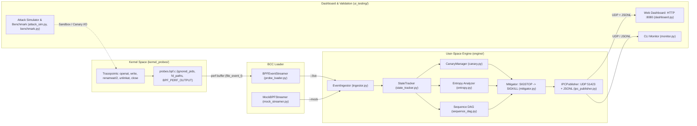
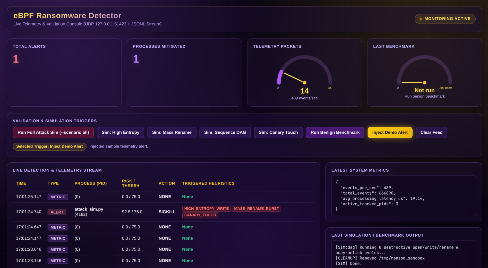

<p align="center">
  
  
  
  
  
</p>

# eBPF Ransomware Detector

**A real-time Linux ransomware detection, process-tree mitigation, and live telemetry system built on eBPF syscall tracepoints and multi-layered behavioral heuristics.**

The detector intercepts filesystem syscalls in kernel space via BCC/eBPF, streams fixed-layout events to a user-space Python scoring daemon, terminates offending process trees using a two-stage `SIGSTOP` → `SIGKILL` cascade, and broadcasts real-time telemetry to a zero-dependency web dashboard and CLI monitor.

---

## 1. Overview & Architecture

The system is split into three decoupled components bound by two shared contracts:
- **Contract A ([`common/event_defs.h`](common/event_defs.h))**: 632-byte `struct file_event_t` streamed from eBPF tracepoints to the detection engine.
- **Contract B ([`common/ipc_schema.json`](common/ipc_schema.json))**: JSON `ALERT` and `METRIC` telemetry packets broadcast over non-blocking UDP (`127.0.0.1:51423`) and appended to `/tmp/aegis_telemetry.jsonl`.



---

## 2. Key Features

### Kernel Space (`kernel_probes/`)
- **Syscall Tracepoints ([`probes.bpf.c`](kernel_probes/probes.bpf.c))**: Hooks `sys_enter_openat`, `sys_exit_openat`, `sys_enter_write`, `sys_enter_renameat`, `sys_enter_renameat2`, `sys_enter_unlinkat`, and `sys_enter_close`.
- **In-Kernel Context & Filtering**: Maintains `fd_paths` (`(tgid, fd) → filename`), `pending_open`, and `ignored_pids` (auto-excluding the detector PID), while filtering pseudo-filesystems (`/proc`, `/sys`, `/dev`, `/run`).
- **Payload Sampling**: Captures the first 64 bytes (`PAYLOAD_SAMPLE_SIZE`) of write buffers via `bpf_probe_read_user()` for inline entropy checks.
- **Lazy BCC Wrapper ([`probe_loader.py`](kernel_probes/probe_loader.py))**: `BPFEventStreamer` decodes the 632-byte `FileEvent` `ctypes.Structure` into Python dicts and imports `bcc` lazily so `--mock` development works without BCC installed.

### User-Space Detection & Mitigation Engine (`engine/`)
Each PID is tracked in [`StateTracker`](engine/state_tracker.py) with sliding windows (`1.0 s` I/O velocity) and exponential time-decay ($S(t) = S(t_0) e^{-0.5 (t - t_0)}$). Crossing `KILL_THRESHOLD = 75.0` triggers mitigation:

| Heuristic | Module | Trigger Condition | Score Delta |
|---|---|---|---|
| **Canary Honeyfile Tripwire** | [`heuristics/canary.py`](engine/heuristics/canary.py) | `WRITE`, `RENAME`, or `UNLINK` on deployed decoy files in `/tmp/aegis_canary_zone` | `+100.0` (instant) |
| **Stage 1: Inline Entropy & Magic Overwrite** | [`heuristics/entropy.py`](engine/heuristics/entropy.py) | `OPEN` stashes known magic header (`%PDF`, `PK\x03\x04`, PNG, JPEG, GZIP, ELF); subsequent high-entropy `WRITE` ($H_{64} > 5.4$) overwrites it | `+35.0` |
| **Stage 2: On-Disk Verification** | [`heuristics/entropy.py`](engine/heuristics/entropy.py) | When score $\ge 40.0$, `EVENT_CLOSE` reads 4096 bytes from disk; triggers if $H_{4096} > 7.6$ and extension is not in `HIGH_ENTROPY_EXTENSIONS` | `+30.0` |
| **Behavioral Sequence DAG** | [`heuristics/sequence_dag.py`](engine/heuristics/sequence_dag.py) | In-place (`OPEN → WRITE(high H) → RENAME(ext change)`) or copy-and-shred (`OPEN(A) → WRITE(B, high H) → UNLINK(A)`) within `2.0 s` | $+10 \times 1.5^{\min(C, 30)}$ |
| **Extension-Uniformity Burst** | [`state_tracker.py`](engine/state_tracker.py) | $\ge 6$ distinct files renamed to the same unknown extension within `3.0 s` | `+50.0` |

- **Two-Stage Process Tree Mitigation ([`mitigator.py`](engine/mitigator.py))**: Walks `/proc/<pid>/task/*/children`, skips `OS_CRITICAL_WHITELIST` binaries (`systemd`, `init`, `sshd`, `kthreadd`, etc.), freezes the tree with `SIGSTOP`, and terminates with `SIGKILL` (or logs `DRY_RUN_KILL` under `--dry-run`, enabled by default).
- **Alert Deduplication ([`main_daemon.py`](engine/main_daemon.py))**: Emits one `ALERT` per flagged PID and short-circuits repeated heuristic evaluation for already-mitigated PIDs.
- **Non-Blocking IPC ([`ipc_publisher.py`](engine/ipc_publisher.py))**: Sends `ALERT` packets immediately and `METRIC` heartbeats every `0.5 s` via UDP (`127.0.0.1:51423`) and `/tmp/aegis_telemetry.jsonl`.

### Dashboard & Validation Suite (`ui_testing/`)
- **Live Web Console ([`dashboard.py`](ui_testing/dashboard.py))**: Zero-dependency `ThreadingHTTPServer` on port `8080` with a translucent purple–yellow interface, SVG speedometer gauges for packet counts and benchmark throughput, active trigger highlighting, live telemetry table (green `None` vs. red heuristic tags), and `--mock` launcher support.
- **CLI Monitor ([`monitor.py`](ui_testing/monitor.py))**: Lightweight terminal listener for UDP `127.0.0.1:51423` or tailing `/tmp/aegis_telemetry.jsonl`.
- **Attack Simulator ([`attack_sim.py`](ui_testing/attack_sim.py))**: Safe synthetic generator executing real filesystem operations inside `/tmp/ransom_sandbox` and `/tmp/aegis_canary_zone`.
- **Benign Benchmark ([`benchmark.py`](ui_testing/benchmark.py))**: Measures wall-clock time and `/proc/self/status` `VmRSS` over benign file creation/copy/read loops.

---

## 3. Dashboard Preview

<!-- DASHBOARD_PREVIEW_START: Replace the image path below with a screenshot of http://127.0.0.1:8080 -->

<!-- DASHBOARD_PREVIEW_END -->

---

## 4. Prerequisites & Installation

### Standard Python Setup (`--mock` Mode, Dashboard & Tests)
Runtime components use **Python ≥ 3.10 standard library only**. `pytest` is required only for running the test suite.

```bash
git clone https://github.com/magnetar-x/Ransomware-Detector.git
cd Ransomware-Detector

python3 -m venv .venv
source .venv/bin/activate
pip install -r requirements.txt
```

### Linux eBPF Setup (Required Only for `--live` Mode)
Live kernel tracing requires a Linux host with BCC Python bindings, kernel headers, and `root` privileges:

```bash
# Ubuntu / Debian
sudo apt update
sudo apt install -y bpfcc-tools python3-bpfcc linux-headers-$(uname -r) clang make

# Arch Linux
sudo pacman -S bcc python-bcc linux-headers clang make
```

Verify the kernel probe source and loader:

```bash
cd kernel_probes && make check && make lint
```

---

## 5. Usage & Quickstart

### (a) Mock / Dry-Run Mode with the Web Dashboard
Starts the dashboard (`http://127.0.0.1:8080`) and automatically spawns `engine.main_daemon --mock --dry-run`:

```bash
python3 ui_testing/dashboard.py --mock
```

Optional flags:

```bash
python3 ui_testing/dashboard.py --mock --scenario mixed --events-per-sec 500 --port 8080
```

To run the mock daemon and CLI monitor in separate terminals instead:

```bash
# Terminal 1: Engine daemon (mock + safe dry-run)
python3 -m engine.main_daemon --mock --dry-run --scenario ransomware_inplace

# Terminal 2: CLI telemetry monitor (add --metrics to show periodic METRIC packets)
python3 ui_testing/monitor.py --metrics
```

### (b) Live eBPF Mode
Run the detection daemon with root privileges (`--dry-run` is active by default; add `--live-mitigation` to dispatch real `SIGSTOP`/`SIGKILL` signals):

```bash
# Terminal 1: Live eBPF engine in safe dry-run mode
sudo python3 -m engine.main_daemon --live --dry-run

# Or with active process termination enabled:
# sudo python3 -m engine.main_daemon --live --live-mitigation

# Terminal 2: Web dashboard listening to live telemetry (without --mock)
python3 ui_testing/dashboard.py
```

### (c) Running Attack Simulator & Benchmark Scenarios
`attack_sim.py` performs real filesystem I/O inside `/tmp/ransom_sandbox` (and `/tmp/aegis_canary_zone` for `canary`) so it is detected when the engine is running in `--live` mode:

```bash
# Overwrite .pdf sandbox files with high-entropy payloads (triggers Stage 1 + Stage 2 entropy)
python3 ui_testing/attack_sim.py --scenario entropy --cleanup

# Mass-rename sandbox files to .locked (triggers extension uniformity + sequence DAG)
python3 ui_testing/attack_sim.py --scenario rename --ext .locked --cleanup

# Run OPEN->WRITE->RENAME and OPEN(A)->WRITE(B)->UNLINK(A) loops
python3 ui_testing/attack_sim.py --scenario dag --cycles 8 --cleanup

# Touch an existing daemon-deployed canary file in /tmp/aegis_canary_zone
# (exits cleanly with a message if the daemon has not deployed any yet)
python3 ui_testing/attack_sim.py --scenario canary

# Run all scenarios together
python3 ui_testing/attack_sim.py --scenario all --cleanup

# Run benign workload benchmark (no alerts should be triggered)
python3 ui_testing/benchmark.py --files 30 --iterations 2
```

---

## 6. Testing

Run the unit and integration test suite from the repository root:

```bash
pytest engine/tests/ -v
```

Current status: **100 tests passing** across `test_canary.py`, `test_entropy.py`, `test_ingestor.py`, `test_integration.py`, `test_ipc_publisher.py`, `test_mitigator.py`, `test_mock_streamer.py`, `test_sequence_dag.py`, and `test_state_tracker.py`.

---

## 7. Project Structure & Safety Disclaimer

```text
Ransomware-Detector/
├── common/
│   ├── event_defs.h              # Contract A: 632-byte C struct file_event_t
│   └── ipc_schema.json           # Contract B: Telemetry JSON schema (ALERT / METRIC)
├── kernel_probes/
│   ├── probes.bpf.c              # eBPF syscall tracepoint programs
│   ├── probe_loader.py           # BCC perf-buffer loader (BPFEventStreamer)
│   ├── Makefile                  # Header/contract check & py_compile lint
│   └── tests/test_stream.py      # Standalone live eBPF event printer
├── engine/
│   ├── main_daemon.py            # CLI orchestrator (--mock / --live, --dry-run / --live-mitigation)
│   ├── ingestor.py               # Dual-mode event consumer (live BCC <-> MockBPFStreamer)
│   ├── mock_streamer.py          # Synthetic kernel event generator (6 scenarios)
│   ├── state_tracker.py          # Per-PID sliding windows, score decay, extension uniformity
│   ├── mitigator.py              # Two-stage SIGSTOP -> SIGKILL process-tree terminator
│   ├── ipc_publisher.py          # Non-blocking UDP (51423) + JSONL telemetry broadcaster
│   ├── config.py                 # Thresholds, scoring weights, magic signatures, paths
│   ├── heuristics/               # canary.py, entropy.py, sequence_dag.py
│   └── tests/                    # 100 unit & integration tests (pytest)
├── core_engine/                  # Spec-compatible import shims re-exporting engine/*
├── ui_testing/
│   ├── dashboard.py              # Live web dashboard (HTTP :8080, UDP :51423, JSONL tail)
│   ├── monitor.py                # CLI telemetry monitor
│   ├── attack_sim.py             # Safe synthetic ransomware simulator
│   └── benchmark.py              # Benign I/O & RSS memory benchmark
└── requirements.txt              # Test dependency (pytest>=8.0)
```

> **Safety Disclaimer:**
> Active mitigation (`--live-mitigation`) dispatches `SIGSTOP` and `SIGKILL` to processes and their child trees in `/proc`. Always validate new heuristics or simulations in `--dry-run` mode (the default) and keep `attack_sim.py` pointed strictly at isolated sandbox directories (`/tmp/ransom_sandbox`, `/tmp/aegis_canary_zone`). Never run unverified attack simulations on production machines or against real user directories.

---

## License

MIT
